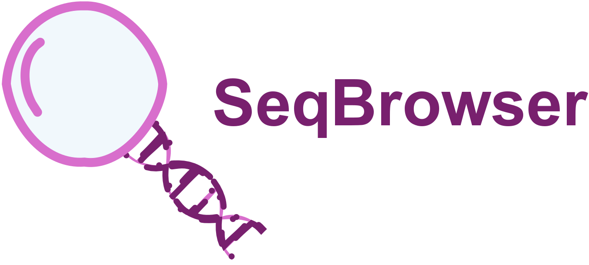

# Seq-Browser <picture><source media="(prefers-color-scheme: dark)" srcset="docs/brand/seqbrowser-logo-text-dark.svg"></picture>

Seq-Browser is a database of sequencing assays and analysis tools. It is an AI-assisted, continuously self-updating catalogue of sequencing-based omics methods (single-cell, spatial, etc) and complementary computational analysis software. 

- **Browse the database on the website!:** https://robertt4n.github.io/Seq-Browser/
- **Point your LLM at the machine-readable database container:** [`docs/llms.txt`](docs/llms.txt)

## Rationale and purpose

Frederick Sanger's invention of "dideoxy chain termination" DNA sequencing in the 1970s, enabled scientists to "read" the genome; leading to the assembly of the entire human genome in 2003, costing $3B USD. In the early 2000s, next-generation-sequencing (NGS) rapidly expanded the capabilities of genomics research, allowing scientists to sequence the genome of an organism at unprecedented speed. Such technologies paved the way to success for large-scale sequencing projects such as The Cancer Genome Atlas (TCGA) and Encyclopedia of DNA Elements (ENCODE), which greatly accelerate the rate of basic and translational biomedical research.

In the successive decades, there has been an insurmountable, cambrian explosion of different methods to sequence not just DNA, but also RNA, protein, epigenetic modifications, and so forth. In addition to NGS platforms, new chemistries and molecular strategies are being released to the scientific community at a blinding rate. Our hypothesis is that it is not possible to stay updated with such literature through social media or preprint/publication. 

The Seq-Browser was built to be an automatically updating database of such methods (and accompanying computational tools). The database is browseable and aims to be a resource for researchers aiming to compare existing methods, develop new methods, or assess the current landscape of their 'omics field of interest.

## Autonomous method retrieval

```
Fetch      bioRxiv/medRxiv + Europe PMC (PubMed journals) + OpenAlex + etc:
   |       new papers, preprints, media release
   |
Triage     free rule-based filter (~1,200 papers/week -> ~100):
   |       abstract check + full-text naming scan
   |      
   |
Classify   cheap language model reads each candidate
   |       -> structured labels + quoted evidence   [next phase]
   |
Review     weekly pull request and review
   |
Masterlist   (continuously growing ground truth database)
           -> METHODS.md, docs/methods.json/.csv, llms.txt
```

## Method labelling

Each method is tagged on independent axes; allowed values live in [`taxonomy.yaml`](taxonomy.yaml):
**category** (wet / dry), **readouts** (3d-genome, rna, histone-modification, ...), **resolution** (bulk / single-cell / spatial / subcellular), **scope** (genome-wide / targeted), **chemistry** (proximity-ligation, mnase, tn5, droplet-microfluidics, ...), plus **variant_of** links to parent methods (e.g. RCMC -> Micro-C).

Computational methods are collected in a similar tagging fashion.

## Contributing to the database

Use the **[Submit page](https://robertt4n.github.io/Seq-Browser/submit.html)**, which opens a pre-filled submission issue. 
Submissions by this approach are added to the weekly trawl with priority. If you have suggestions to improve this resource, please please contact me on [Twitter](https://x.com/RobertT4n) or [LinkedIn](https://www.linkedin.com/in/robert-tan-597a57147/). Thank you :)
