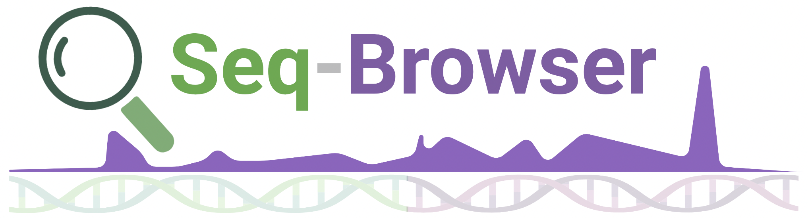
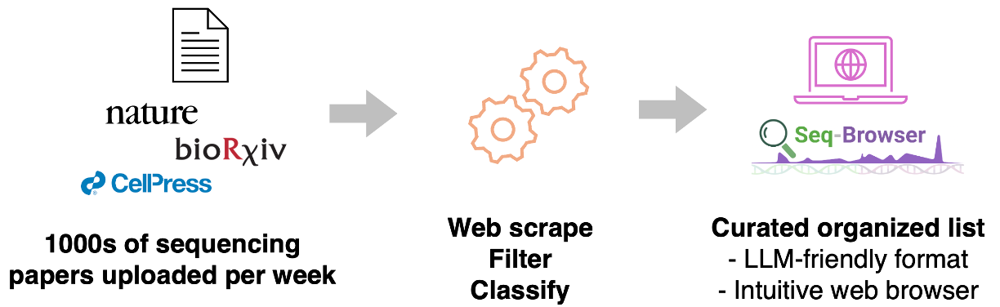

# Seq-Browser 

A browser for sequencing assays: a curated, continuously updated catalogue of sequencing-based methods (bulk, single-cell, spatial), tagged by what they measure and how, and readable by both people and LLMs.

- **Full database, one file:** [`METHODS.md`](METHODS.md). Point an LLM here instead of making it search the web.
- **Machine-readable:** [`docs/methods.json`](docs/methods.json), [`docs/methods.csv`](docs/methods.csv), [`docs/llms.txt`](docs/llms.txt)
- **Website:** https://robertt4n.github.io/Seq-Browser/ (Table, Analysis, About)



## Rationale

Frederick Sanger's invention of DNA sequencing in the 1970s allowed scientists to "read" the genome. This method called Sanger sequencing utilized the concept of dideoxy chain termination to sequence DNA and lead to the sequencing of the entire human genome in 2003, costing $3B USD.

In the early 2000s, next-generation sequencing (NGS) methods were developed that quickly expanded the capabilities of genomics research, allowing scientists to sequence the genome of an organism at an unprecedented level of detail. Such technologies have led to the success of large-scale sequencing projects such as The Cancer Genome Atlas (TCGA) and Encyclopedia of DNA Elements (ENCODE), which greatly accelerate the rate of basic and translational biomedical research.

In recent years, there has been a remarkable explosion of different sequencing assays that can profile not just DNA, but also RNA, protein, and/or epigenetic modifications. In addition to utilising NGS platforms, some methods may also utilise microfluidic systems (to sort by single cells), or microscopy-based platforms (to preserve spatial information). Such emerging methods are being released to the scientific community at a blinding rate, and new ones are often only named deep inside a paper's Results.

Seq-Browser catalogues them and keeps the list up to date automatically.

## How it works

```
fetch.py      bioRxiv/medRxiv + Europe PMC (PubMed journals): new papers, full text when open access
   │
triage.py     free rule-based filter (~1,200 papers/week -> ~100): abstract check + full-text naming scan
   │          ("an approach we call X", "creating X, which ...") to catch methods named only in Results
   │
classify      language model reads each candidate -> structured labels + quoted evidence   [next phase]
   │
review        weekly pull request; a human approves/rejects each candidate
   │
masterlist/methods/*.yaml   one file per method (the source of truth)
   │
build.py      validates every entry against taxonomy.yaml -> METHODS.md, docs/methods.json/.csv, llms.txt
```

Any push that changes `masterlist/` rebuilds the outputs automatically (`.github/workflows/build.yml`).

## Labels

Each method is tagged on independent axes; allowed values live in [`taxonomy.yaml`](taxonomy.yaml):
**category** (wet / dry), **readouts** (3d-genome, rna, histone-modification, ...), **resolution** (bulk / single-cell / spatial / subcellular), **scope** (genome-wide / targeted), **chemistry** (proximity-ligation, mnase, tn5, droplet-microfluidics, ...), plus **variant_of** links to parent methods (e.g. RCMC -> Micro-C).

Computational (dry) methods are collected but kept "under construction" until curated.

## Adding or fixing a method

1. Add `masterlist/methods/<id>.yaml` (copy an existing one; `<id>` = lowercase-hyphenated name).
2. Give `reference.doi` or `reference.title`, then `python pipeline/resolve_refs.py <id>` fills in the citation.
3. `python pipeline/build.py` to validate and regenerate. Commit and push.

## Benchmark

`benchmark/benchmark.yaml` holds deliberately hard papers (method named only in Results, dry vs wet, papers that use but don't invent a method). `python pipeline/benchmark.py` scores the pipeline against them; every pipeline change must keep them passing.
